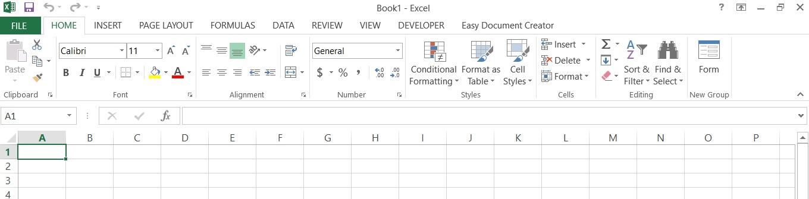
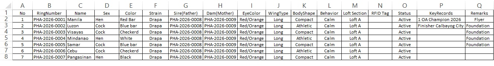
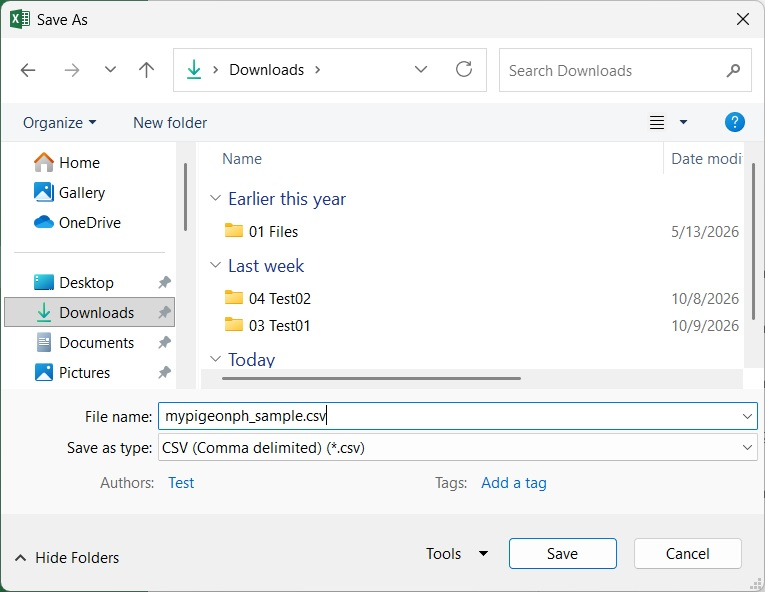

# How to Create and Import Your CSV Data

Follow these step-by-step instructions to format and import your pigeon data into **My Pigeon PH**.

---

### Step 1: Open a Spreadsheet Program

On your laptop or computer, open **Microsoft Excel** or any spreadsheet program.

---

### Step 2: Set Up Headers and Add Entries

Type out your column headers and fill in your pigeon information row by row. Make sure your headers match the required format:

* `No`, `RingNumber`, `Name`, `Sex`, `Color`, `Strain`, `Sire(Father)`, `Dam(Mother)`, `EyeColor`, `WingType`, `BodyShape`, `Behavior`, `Loft Section`, `RFID Tag`, `Status`, `KeyRecords`, `Remarks`

---

### Step 3: Save as a CSV File

1. Click on **File**, then select **Save As**.
2. Name your file (for example: `mypigeonph_sample.csv`).
3. Under the **"Save as type"** dropdown menu, choose **CSV (Comma delimited) (*.csv)**, then click **Save**.

---

### Need Assistance?
If you encounter errors during import, ensure your CSV headers match the required structure or reach out to developer support at **mypigeonph@gmail.com**.
